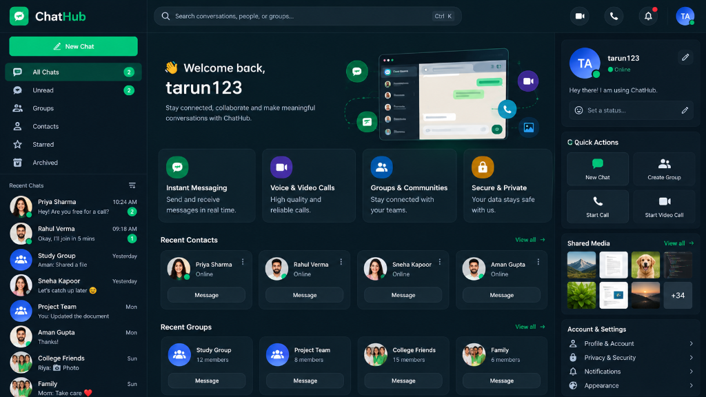
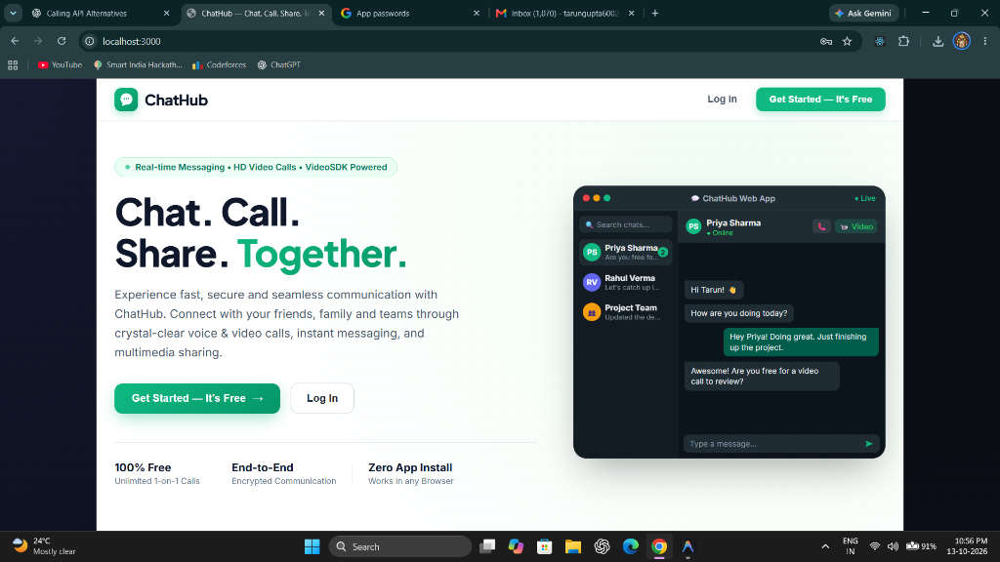
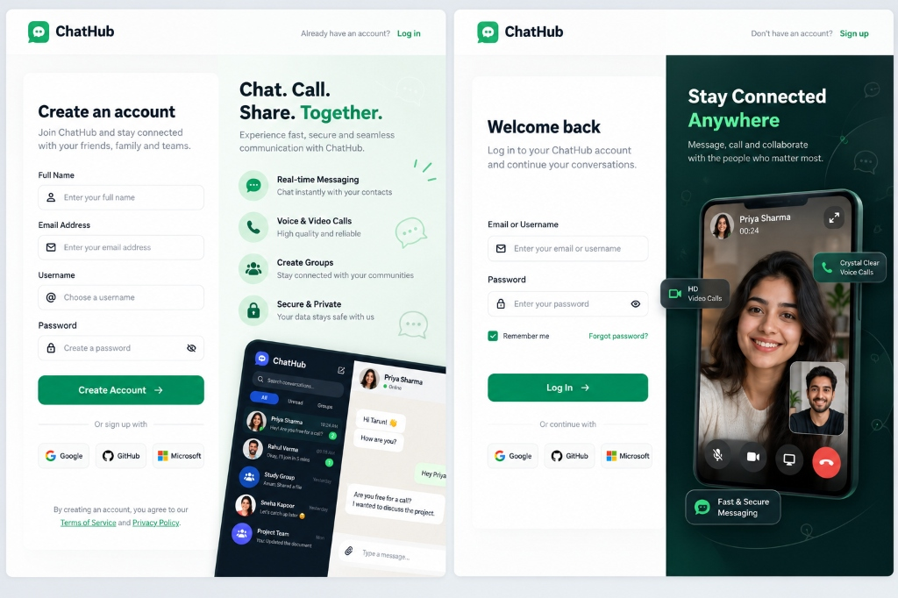
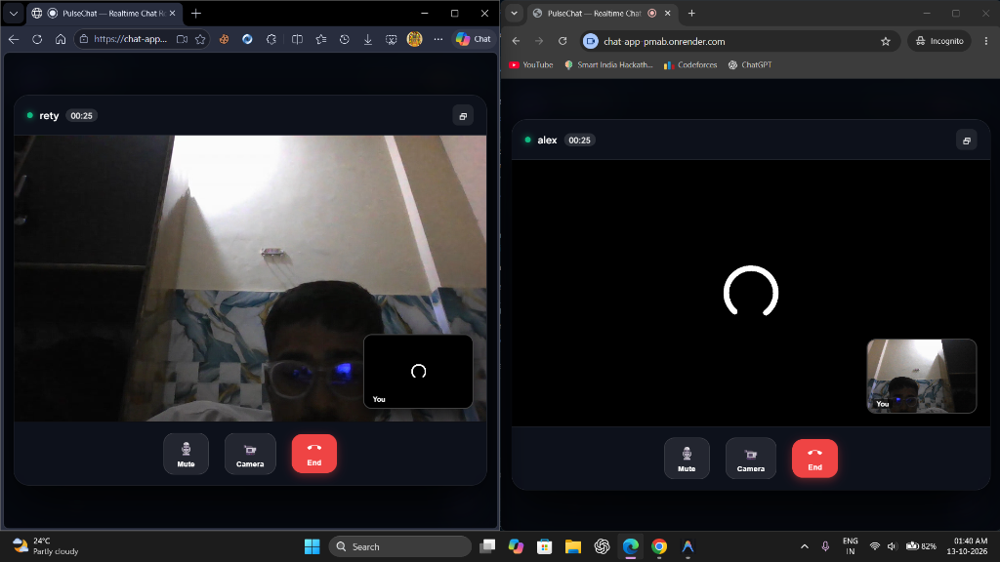

# 💬 ChatHub — Real-Time Chat, HD Calls & Native AI Assistant

[](https://chat-app-pmab.onrender.com)
[](LICENSE)
[](https://reactjs.org/)
[](https://vitejs.dev/)
[](https://socket.io/)
[](https://turso.tech/)
[](https://developer.mozilla.org/en-US/docs/Web/API/SubtleCrypto)
[](https://ai.google.dev/)

> 🚀 **Live Demo**: **[https://chat-app-pmab.onrender.com](https://chat-app-pmab.onrender.com)**  
> *Experience real-time messaging, AI superpowers, and WebRTC HD calls live in your browser!*

> **ChatHub** is a production-ready, full-stack real-time messaging and HD calling application inspired by WhatsApp Web and Telegram. It combines **military-grade client-side End-to-End Encryption (E2EE)** with **native-feeling AI capabilities** (Tone Adjuster, Multi-Language Translation, Smart Replies, and Chat Summarization) without compromising user privacy.

---

## 📸 Screenshots & Visual Tour

<div align="center">

### 🌙 ChatHub Dark Mode Dashboard & Hub
*Complete hub featuring instant messaging, active contacts, group cards, and quick actions.*
<br/>


<br/><br/>

### 📱 Responsive Landing Page & Experience
*Landing page showcasing real-time messaging, zero app installation, and cross-platform compatibility.*
<br/>


<br/><br/>

### 🔐 Multi-Step Auth, Mobile View & Video Calling UI
*User onboarding with OTP verification, mobile-optimized chat UI, and crystal-clear voice/video calling.*
<br/>


<br/><br/>

### 📞 Live Peer-to-Peer Video Call
*WebRTC-powered low-latency video and audio calling with interactive in-call controls.*
<br/>


</div>

> 💡 **Tip for Adding More GIFs or Screenshots:**  
> You can also drag and drop recordings or animated `.gif` files into any GitHub issue or PR description to generate a permanent CDN link, and paste `` right here!

---

## 🌟 Key Features

### 🔒 Military-Grade End-to-End Encryption (E2EE)
- **Zero-Knowledge Architecture**: Messages, photos, and voice notes are encrypted on the sender's device before hitting the network using standard **Web Crypto API (AES-256-GCM)** with **PBKDF2/SHA-256** key derivation.
- **Server Blind**: The Node.js server and Turso database store strictly encrypted ciphertext (`e2ee:v1:IV:Ciphertext`). Not even server administrators or ISPs can read your messages.
- **Client-Side Decryption**: Only the sender and intended recipient can decrypt and view messages on their local devices.

### 🤖 Native-Feeling AI Integrations
- **✨ Tone Adjuster**: Directly embedded in the chat input bar. Switch message tone on the fly between **Make Professional**, **Make Friendly**, or **Shorten Text** before sending.
- **🌐 In-Chat Multi-Language Translation**: Hover over any message and click the `Languages` icon to translate instantly into **Hindi, English, Spanish, French, German, Arabic, Urdu, Bengali, Marathi, Gujarati, Punjabi, or Russian** with smart multi-engine fallback.
- **💡 Smart Suggested Replies**: Horizontal dock above the chat input suggesting quick, contextual replies (*"Sounds good!"*, *"I'll check and let you know"*, *"Thanks!"*).
- **📊 Contextual AI Slide-Over Panel**: Slack thread-style panel powered by Google Gemini for:
  - Instant conversation summarization
  - Action item & task extraction
  - Natural language Q&A about chat history

### 💬 Complete WhatsApp Web Style Experience
- **Real-Time Direct & Community Messaging**: Seamless 1-on-1 private messaging and global community chat powered by WebSockets (`Socket.io`).
- **WhatsApp Status Ticks**:
  - Single check: Sent
  - Double grey check: Delivered
  - Double blue check: Read
- **In-App WhatsApp Modals**:
  - **Delete Message**: Choose between **"Delete for everyone"** or **"Delete for me"** (persists locally across refreshes) with custom in-app popups (no browser alerts).
  - **Clear Chat** & **Delete Chat**: Protected by confirmation modals.
- **Rich Media**:
  - Voice notes with custom interactive waveform audio player.
  - Photo attachments with built-in lightbox preview.
  - View Once photos that auto-expire upon opening.
- **Interactive Messaging**: Message editing, quote replies, emoji reactions with counter pills, and live typing indicators.
- **Contact Management**: Instant user search, contact blocking & unblocking with strict message delivery gating.

### 📞 HD Audio & Video Calling
- One-click peer-to-peer audio and video calling powered by **VideoSDK** and **WebRTC**.
- Incoming call ring modal with audio chimes.
- Floating active call overlay with camera/microphone toggle and screen sharing.
- Persistent call log history.

### 🔐 Authentication & Profile Management
- Email and password authentication with OTP verification (via Gmail SMTP, Resend, or Brevo).
- One-Click Google OAuth integration.
- Custom avatar customization (colors and photo uploads) and personal bio settings.

---

## 🛠️ Tech Stack

| Layer | Technologies |
|---|---|
| **Frontend** | React 19, Vite 8, Lucide React, HTML5 Audio & Canvas |
| **Styling** | Vanilla CSS (Tailored WhatsApp Dark/Light Themes, Glassmorphism, Micro-animations) |
| **Backend** | Node.js, Express 5, Socket.io 4.8 |
| **Database** | Turso Cloud SQLite (`@libsql/client`) with auto-migration |
| **Cryptography** | Web Crypto API (`window.crypto.subtle`), AES-256-GCM, PBKDF2 |
| **AI Engine** | Google Gemini API (`gemini-flash-lite-latest` / `gemini-2.5-flash`), OpenAI fallback |
| **Audio/Video** | VideoSDK (`@videosdk.live/react-sdk`), WebRTC, DTLS-SRTP |
| **Email/Auth** | Nodemailer, Resend API, Brevo API, JSON Web Tokens (JWT) |

---

## 📂 Project Structure

```text
CHAT-APP/
├── src/
│   ├── components/
│   │   ├── ActiveCallOverlay.jsx     # Floating video/audio call window
│   │   ├── AuthPage.jsx              # Login, register & OTP verification
│   │   ├── ChatFooter.jsx            # Message input, voice recorder, Tone Adjuster & Smart Replies
│   │   ├── ChatHubAiPanel.jsx        # Slide-over AI analysis panel
│   │   ├── MessageItem.jsx           # Message bubble, E2EE view, translation & delete modal
│   │   ├── MessagesContainer.jsx     # Chat viewport & WhatsApp E2EE banner
│   │   ├── WhatsAppChatWindow.jsx    # Chat header, call triggers & context menu
│   │   ├── WhatsAppSidebar.jsx       # Left chat list, user avatars & search
│   │   └── WhatsAppLayout.jsx        # Responsive WhatsApp shell container
│   ├── context/
│   │   ├── AuthContext.jsx           # User authentication state
│   │   ├── SocketContext.jsx         # WebSockets, E2EE hooks & conversations
│   │   ├── ThemeContext.jsx          # Dark / Light mode toggle
│   │   └── WebRTCContext.jsx         # VideoSDK audio/video call engine
│   ├── utils/
│   │   └── e2ee.js                   # Client-side AES-256-GCM Web Crypto engine
│   ├── App.jsx                       # Root app router
│   ├── index.css                     # Complete design system & custom styles
│   └── main.jsx                      # Vite entry point
├── test/
│   └── ai-suite.test.js              # Comprehensive 25-step automated test suite
├── aiService.js                      # Server-side Gemini & OpenAI provider adapter
├── database.js                       # Turso SQLite cloud schema & queries
├── emailService.js                   # SMTP & API email delivery handler
├── index.js                          # Express & Socket.io server entry
├── package.json
└── vite.config.mjs
```

---

## 🚀 Getting Started

### 1. Prerequisites
- **Node.js**: v18.0.0 or higher
- **npm**: v9.0.0 or higher
- A **Turso Database** account (or local SQLite)

### 2. Clone the Repository
```bash
git clone https://github.com/tarungupta6002-ctrl/CHAT-APP.git
cd CHAT-APP
```

### 3. Install Dependencies
```bash
npm install
```

### 4. Configure Environment Variables
Create a `.env` file in the project root based on `.env.example`:

```env
# Server
PORT=3000

# Turso Cloud SQLite Database
TURSO_DATABASE_URL=libsql://your-database-name.turso.io
TURSO_AUTH_TOKEN=your-turso-auth-token

# VideoSDK (Audio / Video Calling)
VIDEOSDK_API_KEY=your-videosdk-api-key
VIDEOSDK_SECRET_KEY=your-videosdk-secret-key

# Google OAuth (Optional)
GOOGLE_CLIENT_ID=your-google-client-id

# Email Service (OTP verification)
EMAIL_HOST=smtp.gmail.com
EMAIL_PORT=465
EMAIL_USER=your-email@gmail.com
EMAIL_PASSWORD=your-app-password
EMAIL_FROM="ChatHub Security" <your-email@gmail.com>

# AI Assistant (Google Gemini)
AI_PROVIDER=gemini
GEMINI_API_KEY=your-gemini-api-key
GEMINI_MODEL=gemini-flash-lite-latest
AI_DAILY_QUOTA=25
```

### 5. Build & Run

#### Development Mode:
```bash
# Start frontend dev server
npm run client

# Start backend server
npm run server
```

#### Production Mode:
```bash
# Build production bundle
npm run build

# Start server
npm start
```
Open **[http://localhost:3000](http://localhost:3000)** in your browser.

---

## 🧪 Automated Testing

Run the full automated test suite covering AI adapters, authorization isolation, database queries, and calling tokens:

```bash
npm test
```

```text
=======================================================
ChatHub AI — Running Automated Test Suite
=======================================================
[1] AI Provider Adapter Unit Tests:           ✓ (5/5 Passed)
[2] Database Authorization & Scope Isolation: ✓ (3/3 Passed)
[3] Atomic Quota & Persistence Tests:         ✓ (4/4 Passed)
[4] HTTP API Endpoint Security & Routing:     ✓ (10/10 Passed)
[5] Calling & Messaging Regression Checks:    ✓ (3/3 Passed)
=======================================================
Test Results: 25 Passed, 0 Failed
=======================================================
```

---

## 🔒 Security & Privacy Notice
ChatHub takes privacy seriously:
- **E2EE**: Direct messages are encrypted using client-side generated keys. Plaintext messages never transit through or reside on any server.
- **Password Hashing**: User credentials are protected using salted `bcryptjs` hashing.
- **Token Security**: Sessions are secured via JSON Web Tokens (JWT) with HTTP-only transmission.

---

## 📄 License
This project is licensed under the **MIT License** — feel free to use, modify, and distribute it for personal and commercial projects.
